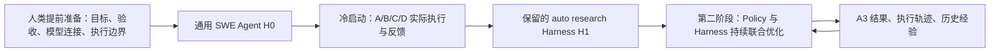
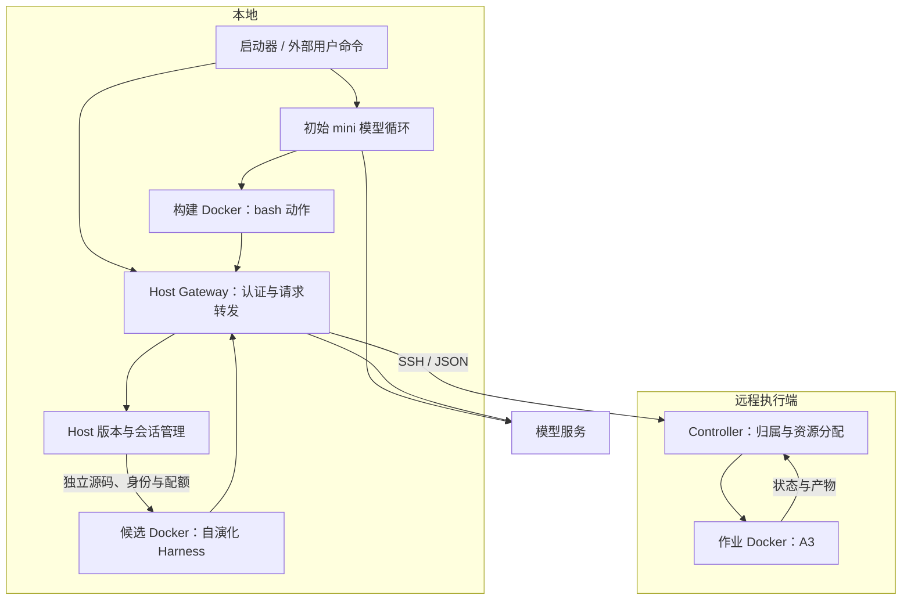
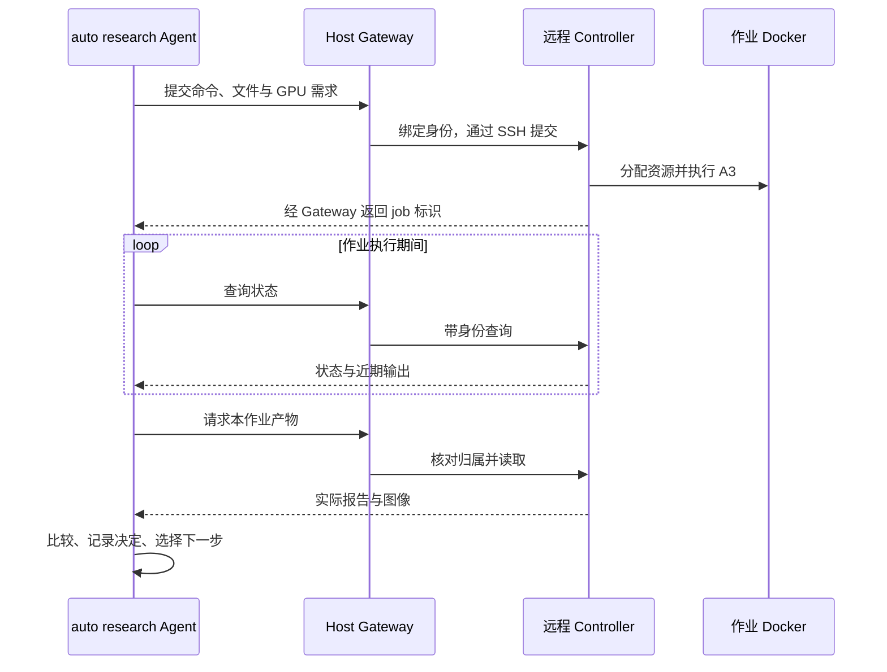

# A3 Research Agent 系统架构

本项目让 Agent 同时改进两个对象：机械臂的 Policy，以及组织实验的 Harness。A3 提供仿真、相机、策略和评测接口；人类提前准备运行与验收边界；SWE Agent 在边界内形成 auto research 工具、实验流程、反思与记忆。

本页解释系统怎样运行、各部分怎样协作。启动命令见[使用教程](tutorial.md)，文件应放在哪里见[目录职责](project-structure.md)。

## 两阶段 RSI 要解决什么

Policy 接收机器人观测并产生动作，影响机械臂能否完成任务。Harness 负责模型调用、工具执行、实验记录、历史检索与后继运行，影响 Agent 能否正确安排实验、理解结果并继续推进。RSI 在这里指 Agent 根据反馈修改自己的 Harness，并让后续执行实际使用修改。

冷启动从通用 mini-SWE-agent 开始。人类给出能力目标、已有 A3 接口和固定权限；Agent 自己选择实现形态。阶段一验证四条能力链：

| 能力 | 必须实际发生的过程 |
| --- | --- |
| A：Policy 优化 | 理解 A3 接口、观察仿真与相机、提出候选、配对评测、保留或拒绝 |
| B：Harness 优化 | 保存轨迹、回看问题、形成修改、后继加载、比较并选择 |
| C：受限执行 | 自己的合法操作成功，跨实验读写、作业操作和资源绕过被拒绝 |
| D：持久记忆 | 在当前执行中主动保存经验，新会话找回相关先例、核对来源并用于后续行动 |

阶段一允许候选没有收益。正确执行并拒绝退化候选，也能完成优化闭环。记忆的组织方式由 Agent 决定，可使用文件、表格、数据库或其他形式；人类提供历史材料的访问与隔离能力。

第二阶段在此起点上持续优化 Policy 与 Harness，关注任务表现、模型调用、计算时间和失败恢复等实际代价。更有区分度的 Policy 任务条件与评估协议由团队继续调研；跨 Agent 协调与去重也尚未形成完整策略。

## 四个执行单元怎样配合

当前默认方案把 Agent 执行放在本地，把 A3 仿真与计算放在远程执行端。代码由同一个项目维护，部署在不同机器上承担不同职责。

| 执行单元 | 运行内容 | 持有的权限 |
| --- | --- | --- |
| 本地 Host | 启动器、Gateway、版本服务、Docker 生命周期监督 | 模型认证、SSH、身份分配、固定挂载和本地资源上限 |
| 本地构建或候选 Docker | 初始 mini 的动作，或生成后 Harness 的完整执行循环 | 本工作区读写、指定公共与历史材料读取、绑定身份的 Gateway 请求 |
| 远程 Host Controller | 作业归属检查、资源分配、Docker 创建与状态管理 | 执行端 Docker 与共享 GPU 租约 |
| 远程作业 Docker | A3 仿真、渲染、训练或评测命令 | 本作业目录和分配的计算资源 |

初始 mini 的模型循环在本地 Host 运行，bash 动作通过 `DockerEnvironment` 在构建 Docker 中执行。模型具备哪种工具，由该阶段的 Agent 配置决定；bash 可以运行 Python 命令。

生成后的 Harness 则在候选 Docker 中运行自己的模型与工具循环，通过 Gateway 请求模型、提交 A3 作业和创建后继。它改进的是自己的代码；Host 的身份分配、挂载与资源上限保持固定。

Gateway 将候选使用的模型别名映射到部署者配置的服务，调用方拿不到真实模型认证。SSH 只由 Host 用于调用 Controller。作业 Docker 没有模型凭据、SSH 或 Docker socket，网络关闭。

## 一次 A3 实验的完整调用链

Agent 先通过自己的工具读取 A3 的工作流与动作、观测契约，再把实验命令、参数和输入文件提交给 Gateway 的 `/jobs`。

Gateway 从认证中确定实验身份，补入归属字段，经 SSH 调用远程 Controller。调用方不能覆盖自己的身份或传入任意 Host 挂载。Controller 检查并发容量，需要 GPU 时申请租约，为本作业建立独立目录并启动 Docker，返回 job 标识。

长任务提交后异步运行。Controller 的 watcher 跟踪容器完成与时限；Agent 周期查询 `/jobs/{job_id}`，完成后从 artifacts 接口取回报告、图像等结果。Controller 按请求执行，无需单独运行常驻 HTTP 服务。

Agent 根据原始报告核对协议、逐回合结果和异常，再决定保留、拒绝或继续尝试。Host 提供 `/checks/comparison` 检查提交条件的差异与缺失；实际协议的提取、结论解释和候选选择由 Agent 完成。字段一致不会自动证明真实实验可比。

## 版本、运行和身份分别管理

用 $H_k$ 表示一个可执行的 Harness 版本。同一个 $H_k$ 可以在多个新身份下重复测试；一次 run 也可以执行多个不同版本。代码版本、运行会话、远程 job 分别有标识，评测应记录三者之间的关联。

**commit** 是明确提交源码的固定快照。Host 在运行数据中的私有 Git 仓库保存它；这不会修改项目开发分支，也不会自动 push。版本服务只向身份返回其获授权的版本信息。

**worktree** 是从某个 commit 展开的独立工作目录。候选在自己的目录修改代码或写结果，旧版本和其他目录保留原样。Docker 只挂载 worktree 的 `source/` 子目录；`.git` 和共享 Git 对象库位于挂载范围之外。

即时改文件不会自动生成新 commit。Agent 可以通过 `/versions` 保存候选，并在比较后明确选择保留结果。各 run 使用自己的版本存储，跨轮来源由 `parent_run` 与 `source_version` 关联，代码版本树与 session 父子树分别追踪。

会话产物接口支持按字节偏移分段读取长轨迹，每段仍受响应大小限制。协调者可保存偏移并增量取回追加内容，完整轨迹无需因超过单次传输限制而删除或覆盖。该接口负责受控传输；经验提炼、检索和模型上下文组织由 Agent 的 Harness 实现。参数见[Host 执行入口](../runtime/local/README.md)。

初始 mini-SWE-agent 是构建者；经 `/sessions` 运行的生成代码是候选 Harness。候选内模型的实际工具调用及其返回结果构成执行轨迹，远程 `/jobs` 承担仿真和评测计算。执行证据按这条调用链归属，验收不要求每个候选再次创建一层模型。完整能力仍由版本化的 A/B/C/D 标准检验。

运行期间由 SWE 自主执行验收。外部观察者不注入指令或验收意见；等全部 worker 停止后再复核结果，外部审查不会自动导出给后续 Agent。

## 内部自迭代与外部启动共用执行层

外部 `--run-harness <run目录>` 会读取明确选定运行的保留结果，向 Gateway 创建一个新候选 session。Agent 在内部也可以通过自己的工具请求 `/sessions`，上传候选或引用已有版本：

$$
H_k \xrightarrow{\text{run, evaluate, select}} H_{k+1}.
$$

两条路径都会调用同一个 `CandidateRuntime`：Host 固定镜像、分配独立身份、创建工作区与 Docker、登记父子关系、执行相同的并发和资源限制。外部参数并不是另一套 Agent 引擎。

一次 run 内，Harness 可自行组织很多次这样的转换，不需要用户为每代启动脚本。用户主动使用 `--run-harness`，则是在两次 run 之间选择新的起点和当前目标。`--resume-from` 在原 run 内继续同一个版本化任务，保留模型上下文、主身份、工作区和权限；恢复事件单独追加记录。

## 上一轮结果怎样自动成为下一轮起点

Agent 在本轮主工作区留下 `continuation.json`，声明启动命令与保留文件。Host 不判断哪条分支得分最高；它机械读取声明，保存固定快照，生成 `retained.json`。

本地快照保存与 HTTP 文件上传分别处理。Host 保存工作区文件，以及下一轮直接导入保留包时，不套用 HTTP 上传的 128 个文件、20 MiB 限制；工作区路径、身份授权与凭据保护保持生效。Agent 经 `/sessions`、`/versions` 上传文件仍有单次请求限制。从本地保留包启动时，文件留在 Host 内部导入，之后复用既有会话注册、资源分配和 Docker 执行流程。

下一轮 `--run-harness <run目录>` 根据所选运行的 `retained.json` 从固定快照读取源码。启动器自动准备历史索引，保留来源关系，版本化当前目标，再创建新身份；无需人类临时组织材料。

如果运行中断且尚无最终声明，恢复入口使用该轮已保存的执行起点，提供中间产物供 Harness 找回状态；不会把最后创建的候选当作已被选择的版本。没有明确保留结果时，新一轮版本迭代会报出缺失，而不是悄悄从头构建。

历史归档过滤认证与私密推理，保留代码、报告、可见轨迹和来源索引。完整历史只以只读方式交给新一轮的主会话；后继会话通过显式文件交接获得所需材料，不默认共享整轮私有目录。查找先例、建立摘要和记忆索引、判断经验是否适用，仍属于 Agent 的实现与验收。

大型日志和数据库等二进制原始材料可以留在历史归档中，由 Harness 按需使用；固定启动文件清单主要携带代码和紧凑的文本状态。Host 的文件索引描述材料在哪里，D 项则检验 Agent 是否真正找回经验并用于行动。

### 历史归档与 Agent 记忆的职责

持久记忆需要可靠的存储与交接，也需要围绕当前任务组织和使用经验。人类提前准备前一部分，SWE Agent 在自己的 Harness 中实现后一部分。

| 环节 | Host 提供的固定能力 | SWE Agent 自己实现的能力 |
| --- | --- | --- |
| 保存与访问 | 留存原始轨迹、代码和实验产物，过滤认证与私密推理，按授权提供文件 | 自行实现记忆存储，在当前执行中决定哪些事件值得记住，何时写入或更新经验 |
| 索引与来源 | 提供文件路径、大小、校验值和运行来源 | 组织任务条件、实验结果、失败原因、选择理由及原始证据引用 |
| 历史检索 | 允许读取明确交接的历史与本身份工作区 | 根据当前问题检索相关先例，选择需要进入模型上下文的内容 |
| 比较与判断 | 检查提交的实验协议字段是否一致 | 核对实际结果和适用条件，判断旧经验能否用于本次任务 |
| 跨会话延续 | 加载 Agent 明确选择的代码和文件，提供新身份与只读历史 | 选择记忆交接内容，在空模型上下文的新会话中恢复并使用经验 |

例如，Agent 在当前 session 评测并拒绝一个候选后，主动把拒绝条件、结果与来源写入自己的记忆。新 session 面对相关任务时检索这条记录，检查适用条件，随后调整实验方案或选择其他尝试。原始轨迹用于核对当时发生了什么；Agent 的记忆记录用于保存它选择保留的经验。两者都可以使用 JSONL，具体存储与检索方式由 Agent 决定。

D 项验证当前执行中的主动记忆写入、跨会话检索与行动复用。Agent 也可从旧历史补充经验，但应实际展示本轮写入后被新会话复用的链路。后续若要优化记忆模块本身的写入、检索或上下文选择策略，可将其作为 Harness 候选，沿 B 项的反思、实际使用、比较与选择循环继续演化。

## 权限与资源边界

工具种类少可以帮助任务聚焦；实际隔离由执行层落实。即使候选能运行 Python 或创建子进程，它看到的文件、可管理的 job、可获得的认证和计算资源仍由 Docker 与 Host 接口限制。

本地候选只挂载自己的可写目录、明确提供的只读 A3 源码和输入。初始构建环境与生成后的候选分别记录权限；正式 auto research 经过受限工具执行。新的工具或代码不能扩大 Host 的固定授权。

初始构建工作区从选定源码制作隔离副本。启动器把已复制的改动和部署排除项记录为副本自己的 Git 基线，避免将准备过程产生的差异误判为待保护的并发工作；Host 原仓库的内容与提交状态保持原样。

当前本地同时最多五个活动候选，每个候选 2 CPU、2 GiB 内存、256 个进程，临时目录 512 MiB。远程每个 job 为 2 CPU、8 GiB 内存、至多一张 GPU、900 秒时限，同时最多两个 job。单次 run 的总 step 和代数没有上限。

GPU 租约由执行端共同根目录中的锁协调，保证本项目的 Controller 不把同一张卡重复分配给自己的活动作业。共享服务器上的其他调度器独立运行。当前防护目标是避免实验之间误读写和绕过分配，恶意攻击不属于已完成的验收范围。

C 项使用 `/fixtures/isolation` 创建专用异身份作业与哨兵。Agent 以自己的权限验证拒绝，再由 Host 检查对方材料和作业未改变；对方认证保留在 Host。

## 父子会话怎样收尾

Agent 正常退出后，其后继仍可继续运行。祖先能监督后代，后代不能管理祖先；同级和无关身份不能读取彼此的私有会话。

Host 独立于模型调用，每两秒检查已登记的 worker。确认退出后，先保存控制台日志和退出记录，再自动删除该 worker 的 Docker container。源码、checkpoint、记忆和实验产物存放在 Host 工作区，删除 container 后仍可按原 session ID 查询结果。写入这些文件的时机由 Harness 负责。

container 回收与会话关闭分别管理。自动回收只删除已经停止的 container，保留身份关系和远程作业，不影响其他 worker；日志或记录保存失败时保留 container 并记录错误，Host 继续重试。暂停中的 Docker 不回收。恢复时直接接回暂停的 worker；主进程已退出且具备有效恢复入口时，使用原身份与工作区重新创建 container，已完成的辅助 worker 不重跑。

初始构建者只启动一次。提交后，Host 保持现有后继与 Gateway 可用，仅记录状态并等待所有 worker 退出。Host 不因时间、状态变化、未完成声明或错误重新启动通用构建者；后续执行由 SWE 自己组织。

Agent 用 `run-outcome.json` 保存自己的验收声明。全部 worker 停止后，Host 做声明格式与文件可达性检查并保存保留入口；未完成或归档错误只记录，不触发新的模型调用。实际能力由外部事后复核。

删除一个仍有未回收后代的 session，默认返回 HTTP 409 并保留分支。只有显式 `cascade=true` 才级联回收。关闭整次 run 时，启动器拒绝新请求，清理本次登记的候选、远程作业和隔离 fixture；失败记录供后续处理，磁盘证据保留。

每个远程计算 job 有独立时限，完成后释放 GPU。一次 job 可以执行多个 episode 或种子，已有镜像会复用；本地构建 Docker 也会在初始 mini 的多次动作之间复用。是否采用常驻 worker 或 Docker 实例池，需要以后根据实际耗时占比决定。

## 如何观察反馈

Agent 自己保存模型消息、工具调用、实验结果、反思和选择。Host 另保存模型用量、请求开始与结束、错误层、资源等待和父子生命周期，供外部复核。

`gateway-events.jsonl` 的请求关联号帮助区分等待模型、候选容量和远程调用；当前远程调用耗时包含 SSH 与 Controller 处理，尚未完整分拆依赖加载和计算时段。基础设施健康、进程正常退出、A/B/C/D 验收分别核对，实际完成状态来自目标与原始执行证据。

对应实现为本地 `launch.py`、`host_gateway.py`、`candidate_runtime.py`、`candidate_versions.py`、`continuation.py` 和 `recovery.py`，远程为 `remote_jobs.py`。完整 HTTP 字段见 [Host 执行接口](../runtime/local/README.md)。

父版本选择以显式来源为准。最近运行指针只用于定位启动记录，不定义搜索父节点；多个合法分支之间的选择由外部调用者或 Harness 搜索策略作出。每轮的 retained.json 记录本轮明确选择的对外结果，不代表所有候选之间的全局最优。

## Context resume

会话正常退出由生成的 Harness 自己实现。Host 的 `POST /sessions/self/stop` 提供仅结束调用进程的固定入口，保留后继、工作区与远程作业，并撤销该会话令牌。Host 不因模型声明完成或写入终态文件而自动停止 Agent。所有 worker 停止后才检查结果和归档；通过此接口主动停止的 session 不会被 resume 重新唤起。

初始 mini 保留原始对话与工具结果，部署方 system 和共性协议更新为当前版本；生成后的 Harness 通过自身 `resume.json` 加载原 checkpoint。目标、验收与执行说明同样在恢复时采用当前文件，并归档完整版本。Host 私有快照保存注册表、身份、作业归属、主身份与 trial，原 run 的排他锁阻止重复启动。中断保留工作区并暂停候选 Docker；恢复接回原进程，退出的主进程才通过 checkpoint 入口在原身份下重启。远程 job 保留原 owner 与真实状态。

## 单主 Agent 的 Harness 演化

H0 自行提出改动并先写验收清单，再启动一个加载 H1 的候选。H0 保持决策权并检查实际结果：拒绝则回收候选、继续 H0；保留则将主身份原子交给仍在运行的候选，它直接成为 H1 主 Agent，H0 随后退出。测试候选与下一代主 Agent 是同一个 session 在交接前后的不同角色，不额外启动第二份 H1。Policy 优化可以穿插进行。

局部验证 worker 使用普通 `/sessions`，按明确的局部任务完成后退出；主 Agent 将有效改动整合进完整 Harness，才创建接任候选。主 Agent 负责提供实际工具、输入、交接状态与执行程序，并在创建前检查其与验收清单是否一致。一次性测试程序只承担局部验证。

Host 的 `/evolution` 协议记录清单、版本、决策与唯一主身份，不评判改动收益。具体实现、验收内容、模型上下文与记忆交接由 SWE 自行设计。所有 worker 停止后，从最终主身份归档结果，外部监督者才复核 ABCD。接口见 [Host 执行入口](../runtime/local/README.md#主身份与候选试运行)。

## 核心协议与 Agent 自己的提示词

初始 mini 的 Bash 工具、提交标记和工作区路径属于 bootstrap 专用配置；跨代共性的目标职责、权限、测试和交接规则集中维护。

主 Agent 与待接任候选通过 Host 获得同一份版本化核心协议，来源为 `configs/prompts/common.md`。初始 mini 在 system 中加载；生成后的模型调用由 Gateway 根据实际身份附带，避免代际交接遗漏。主 Agent 仍自行编写专属提示词、任务及工具。普通测试 Agent 与 worker 的完整提示词由主 Agent 设计，Host 不给这些身份额外附加核心协议。

角色由 Host 的主身份和 trial 记录判断。启动与恢复采用仓库当前输入，模型对话、工具和专属指令继续保留。运行期间只有 Host 操作者可预览并确认热加载；确认绑定内容摘要，后续请求使用新版本。用量和结束结果记录具体输入清单，完整内容归档在 input-revisions。详见 [输入版本管理](agent-inputs.md)。
