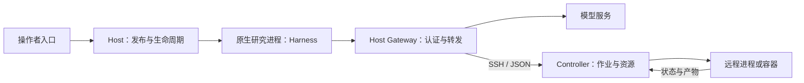

# 系统架构

夜间由单个研究 Agent 完成 Policy、采集、训练、评估与分析。白天由维护者依据原始轨迹改进 Harness，验证后发布源码版本。启动与升级步骤见[使用教程](tutorial.md)，文件归属见[目录职责](project-structure.md)。

## 三个组件的职责

源码位于 `src/a3_research_agent/`，按运行职责分成三个组件。

| 组件 | 负责什么 | 运行位置 |
| --- | --- | --- |
| `harness/` | 模型与工具循环、上下文摘要、计划、记忆、skills 和研究文件操作 | 本地研究进程 |
| `host/` | 发布版本装载、进程生命周期、身份认证、模型转发、输入版本与恢复记录 | 本地 Host |
| `execution/` | 作业归属、排队、GPU 分配、执行、取消、产物与只读导出 | 执行服务器 |

Harness 通过 HTTP 调用 Host。Host 把模型请求送到部署者配置的服务，把作业请求绑定身份后经 SSH 交给 Controller。Controller 只依赖 Python 标准库，按请求运行，无需常驻 HTTP 服务。

本地研究进程直接使用宿主账号运行。Host 将模型认证和 SSH 配置留在自身进程，研究进程只获得本轮 Gateway 令牌及运行所需环境。原生执行采用账号的文件权限；可访问范围应通过专用账号和部署目录管理。远程可选择 `process` 或 Docker，详细资源契约见[进程后端](process-backend.md)。

## 发布、工作区与恢复

操作者从明确的 Git commit 发布 Harness。固定源码缓存在 `.runtime/published-harness/v2/<commit>/`，研究文件保存于 `workspace/<run-id>/<session-id>/`，模型执行记录按开始时间归档到 `trajectories/YYYY-MM-DD_HH-MM-SS-ffffff/`。私有 workspace 映射固定资源身份与研究目录。每轮只运行一个研究 Agent。

Host 的 `launch.py` 负责启动装配；`sessions/processes.py` 负责创建、观察、停止及恢复原生进程；`sessions/workspace.py` 负责工作区定位、受限文件读取和持久写入。进程以 PID、启动标识和实际命令核对身份，避免停止其他进程。

`--resume-from` 恢复同一 run、身份、工作区、checkpoint、工具 journal 与在途作业。普通恢复要求原发布版本和完整模型配置一致。Host 私有状态和会话记录使用明确的原生 schema；不支持旧 builder 或本地容器记录。

维护者通过离线发布事务升级暂停的 run。升级保留研究目录、模型上下文、计划、长期记忆、自写 skills 与作业归属，同时归档旧版本、输入和 checkpoint 边界。事务可以在中断后继续；具体入口见[操作者监督](operator-supervision.md)。

研究 Agent 正常退出后，Host 保存控制台与退出记录。主动调用 `/sessions/self/stop` 会结束本进程、撤销令牌并保留工作区和远程作业；此身份不会被普通恢复重新唤起。Host 关闭整轮时拒绝新请求并回收该轮登记的作业与 fixture，失败项保留供重试。

## 一次实验怎样执行

Agent 先读取 A3 方法 skill 与任务协议，准备 `research/` 中的脚本，再用 `job_submit` 提交命令、文件和资源需求。工具计算附件校验值并检查参数，Host 确定归属，Controller 在统一资源根目录中准入和启动。

Host 在传输前保存 job 编号，Controller 按同一编号创建作业。响应丢失时，Agent 查询已有编号；提交工具不自动重发。`GET /jobs` 可以分页找回该身份的远程作业记录。

独立且输入就绪的作业可以并行提交。等待工具在程序层等待作业终态或操作者通知，减少无效模型调用。报告和图像经产物接口取回；长文本支持分页读取，原始材料继续保存在执行端。

Agent 核对实际协议、逐回合结果与异常，决定下一步研究。`/checks/comparison` 提供提交条件的字段比较；实验解释和候选选择由 Agent 完成。A3 仿真物理、任务计分与资源仍归属独立的 A3 项目。

## GPU 作业管理

Controller 实例共用资源根目录和调度锁。独占模式持有整卡租约；共享模式记录每作业显存预算，限制活动卡数、每卡预算和实际显存压力。未声明预算的托管作业使用部署配置的单作业默认值，显式预算按请求保留。

超过设备或部署上限的请求直接拒绝；暂时没有资源的请求保留同一队列编号。一次准入复用活动作业扫描与 GPU 观测，可靠回收记录不再反复查询容器状态。其他使用者的负载会影响可用资源，共享账本只协调本项目的 Controller。

可识别的初始化 CUDA 显存竞争支持有限重试，保留逻辑作业编号和每次日志；普通脚本失败和自身预算不足不会触发该重试。完成、取消或超时后释放自有租约。完整配置见[环境配置](setup.md)。

## 上下文、记忆与 skills

上下文压缩目标覆盖下一次完整模型输入，包括固定指令、工具、运行状态、摘要和最近的完整工具回合。摘要输出空间根据压缩目标与实际模型窗口计算；必要压缩只有得到完整摘要后才继续。失败时保存 checkpoint 和诊断供恢复。详见[上下文与记忆](context-reliability.md)。

长期记忆保存 Agent 主动提炼的经验及来源；Recall 从原始轨迹检索相关历史，默认搜索可用范围并返回有界片段。研究计划保存任务状态及修订。原地升级继续使用这些文件。

Host 从根目录 `skills/` 发现包含 `SKILL.md` 与 `assets/catalog-entry.json` 的完整方法包，随公共输入和发布包交付正文、引用文件及 helper，并分别记录版本和文件哈希。Agent 自写 skills 保存在研究工作区；输入更新和安装保留其局部修订，将新部署参考包独立保存。Agent 使用多关键词检索并按需读取正文和附件。

显式新任务从选定 run 的 `retained.json` 装载发布版本与 Agent 声明保留的研究知识。知识快照保存选中文件及校验值，新任务初始化自己的对话、计划和作业登记。

## 观察与维护

Gateway 保存模型用量、请求开始与结束、错误层和耗时；Harness 保存模型消息、工具调用与结果；Controller 保存资源、作业状态与产物。事件通过 run、session 和 job 编号关联。

Host 在所有研究进程停止后检查结果声明与文件可达性，保存保留结果。正式验收依目标和原始执行证据复核。模型调用健康、进程退出和研究目标完成分别记录。

目标、验收、Prompt 和工作区指引按版本装载。运行期间只有操作者可以预览并确认输入或反馈更新，规则见[输入管理](agent-inputs.md)与[操作者监督](operator-supervision.md)。
