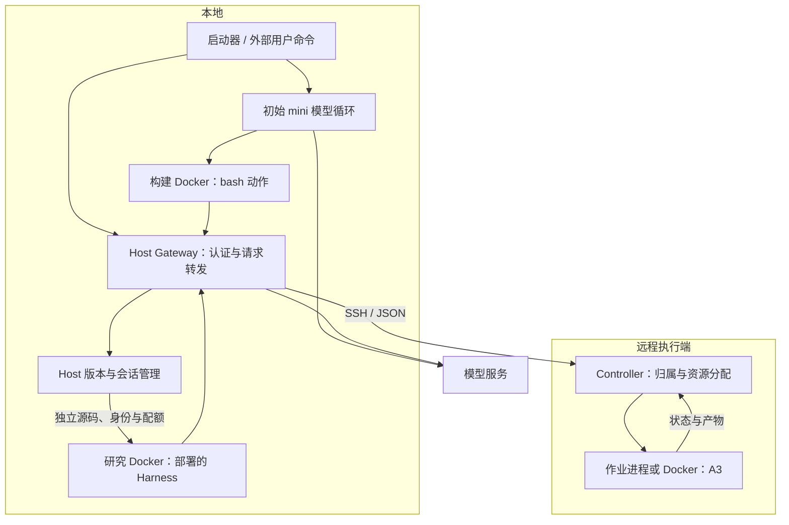
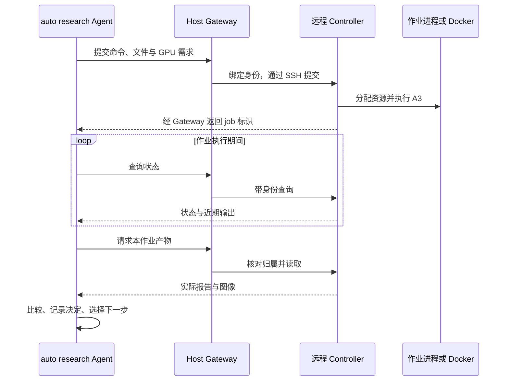

# A3 Research Agent 系统架构

夜间由单个 Agent 自主研究 Policy、采集、训练、评估与分析结果。白天由人类和 Codex 依据原始执行轨迹维护 Harness，包括模型调用、工具、上下文、记忆机制、调度与恢复。Agent 负责报告过程问题及证据，并继续修改研究代码和管理研究知识。

本页解释系统怎样运行、各部分怎样协作。启动命令见[使用教程](tutorial.md)，文件应放在哪里见[目录职责](project-structure.md)。

## 研究与 Harness 维护

Policy 接收机器人观测并产生动作。Harness 负责模型调用、工具执行、上下文、记忆和恢复。第一阶段验证受限研究执行、轨迹、隔离与知识复用；第二阶段在 2×5／2×10 和三个难度的六格协议下持续研究学习型 Policy。

夜间运行使用操作者部署的 Harness。白天维护者复核模型调用、工具参数与结果、作业及 checkpoint，定位并复现问题。验证修改后由操作者发布，恢复时核对运行版本和上下文。远程作业可在本地 Agent 暂停时继续执行。

源码按 `host/`、`execution/`、`harness/` 分组件，维护于 `src/a3_research_agent/`。Host 的 Gateway 路由分组绑定同一运行实例，身份注册表、锁及 checkpoint 共享。Controller 保持标准库依赖，Harness 通过 HTTP 边界访问 Host；完整源码载荷由显式清单交付。所有入口和导入使用该包，详见[目录职责](project-structure.md)。

## 四个执行单元怎样配合

当前默认方案把 Agent 执行放在本地，把 A3 仿真与计算放在远程执行端。代码由同一个项目维护，部署在不同机器上承担不同职责。

| 执行单元 | 运行内容 | 持有的权限 |
| --- | --- | --- |
| 本地 Host | 启动器、Gateway、版本服务、Docker 生命周期监督 | 模型认证、SSH、身份分配、固定挂载和本地资源上限 |
| 本地构建或候选 Docker | 初始 mini 的动作，或生成后 Harness 的完整执行循环 | 本工作区读写、指定公共与历史材料读取、绑定身份的 Gateway 请求 |
| 远程 Host Controller | 作业归属检查、资源分配、进程或 Docker 生命周期管理 | 执行端 Docker 与共享 GPU 租约 |
| 远程作业进程或 Docker | A3 仿真、渲染、训练或评测命令 | 本作业目录和分配的计算资源 |

初始 mini 的模型循环在本地 Host 运行，bash 动作通过 `DockerEnvironment` 在构建 Docker 中执行。模型具备哪种工具，由该阶段的 Agent 配置决定；bash 可以运行 Python 命令。

研究 Harness 在本地容器内执行模型与工具循环，通过 Gateway 请求模型和提交远程作业。

Gateway 将候选使用的模型别名映射到部署者配置的服务，调用方拿不到真实模型认证。SSH 只由 Host 用于调用 Controller。作业 Docker 没有模型凭据、SSH 或 Docker socket，网络关闭。

## 一次 A3 实验的完整调用链

独立且输入就绪的远程作业先在授权资源内并行提交，再统一查询与收集；有依赖的作业按依赖推进。采集与评估中的独立 episode 统一通过 `/run/a3/episode_executor.py` 执行，固定科学参数、seed、快照和输出，复用已完成结果。

普通脚本、参数与结果解析问题由当前 Agent 在当前任务中修复并验证；需要 Host 权限、凭据、服务或资源配置变更时，保留错误证据，向操作者报告所缺条件和具体操作。

Agent 先通过自己的工具读取 A3 的工作流与动作、观测契约，再把实验命令、参数和输入文件提交给 Gateway 的 `/jobs`。

Gateway 从认证中确定实验身份，补入归属字段，经 SSH 调用远程 Controller。调用方不能覆盖自己的身份或传入任意 Host 挂载。Controller 检查并发容量，需要 GPU 时申请租约，为本作业建立独立目录并启动配置的进程或 Docker 后端，返回 job 标识。

Host 在传输前生成并持久保存 job 标识，Controller 使用同一编号创建作业；传输失败的响应携带该编号供后续查询。`GET /jobs` 按身份和 run 分页列出 Controller 元数据并恢复 Host 登记，支持找回历史提交丢失的编号。调度扫描跳过已有可靠回收记录的容器，对其余作业批量检查实际状态；每次提交复用同一次活动作业扫描。Docker 查询失败时停止本次调度，保留已有资源判断边界。

长任务提交后异步运行。Controller 的 watcher 跟踪进程或容器完成与时限；Agent 周期查询 `/jobs/{job_id}`，完成后从 artifacts 接口取回报告、图像等结果。Controller 按请求执行，无需单独运行常驻 HTTP 服务。

Agent 根据原始报告核对协议、逐回合结果和异常，再决定保留、拒绝或继续尝试。Host 提供 `/checks/comparison` 检查提交条件的差异与缺失；实际协议的提取、结论解释和候选选择由 Agent 完成。字段一致不会自动证明真实实验可比。

## 版本、运行和身份分别管理

用 $H_k$ 表示一个可执行的 Harness 版本。同一个 $H_k$ 可以在多个新身份下重复测试；一次 run 也可以执行多个不同版本。代码版本、运行会话、远程 job 分别有标识，评测应记录三者之间的关联。

**commit** 是明确提交源码的固定快照。Host 在运行数据中的私有 Git 仓库保存它；这不会修改项目开发分支，也不会自动 push。同 run 登记研究身份可读取本轮源码版本；跨 run 的版本仍需明确导入或授权。

**worktree** 是从某个 commit 展开的独立工作目录。候选在自己的目录修改代码或写结果，旧版本和其他目录保留原样。Docker 只挂载 worktree 的 `source/` 子目录；`.git` 和共享 Git 对象库位于挂载范围之外。

Host 维护已保存的源码版本和来源关系。操作者选择要部署的 Harness，研究报告关联实际版本。

会话产物接口支持按字节偏移分段读取长轨迹，每段仍受响应大小限制。协调者可保存偏移并增量取回追加内容，完整轨迹无需因超过单次传输限制而删除或覆盖。该接口负责受控传输；研究知识由 Agent 提炼和检索，上下文机制由维护者提供。参数见[Host 执行入口](../agent-inputs/shared/execution.md)。

初始 mini 仅引导首个研究进程。历史 trial 的工具调用和结果仍可按执行身份与远程作业追溯。

运行期间由 SWE 自主执行和判断验收；外界可以低频提供范围明确的反馈，但不能用人工评价替代实验与验收证据。全部研究进程停止后再复核结果；审查不会自动导出给后续 Agent。外界每次热加载或中断前须用户明确批准，流程见 [操作者监督](operator-supervision.md)，文档职责与不变的装载链见 [输入管理](agent-inputs.md#文档职责与读者)。

## 外部启动与恢复

操作者可选择保留版本启动新任务，或恢复同一 run。恢复保留模型上下文、主身份和在途作业。历史 trial 按原始版本查阅。

## 上一轮结果怎样自动成为下一轮起点

Agent 在本轮主工作区留下 `continuation.json`，声明启动命令与保留文件。Host 不替 Agent 判断版本优劣；它机械读取声明，保存固定快照，生成 `retained.json`。

本地快照保存与 HTTP 文件上传分别处理。Host 保存工作区文件，以及下一轮直接导入保留包时，不套用 HTTP 上传的 128 个文件、20 MiB 限制；工作区路径、身份授权与凭据保护保持生效。Agent 经 `/evolution/trials`、`/versions` 上传文件仍有单次请求限制。从本地保留包启动时，文件留在 Host 内部导入，之后复用既有会话注册、资源分配和 Docker 执行流程。

下一轮 `--run-harness <run目录>` 根据所选运行的 `retained.json` 从固定快照读取源码。启动器自动准备历史索引，保留来源关系，版本化当前目标，再创建新身份；无需人类临时组织材料。

如果运行中断且尚无最终声明，恢复入口使用该轮已保存的执行起点，提供中间产物供 Harness 找回状态；不会把最后创建的候选当作已被选择的版本。没有明确保留结果时，新一轮版本迭代会报出缺失，而不是悄悄从头构建。

历史归档过滤认证与私密推理，保留代码、报告、可见轨迹和来源索引。完整历史只以只读方式交给新一轮的主会话；本轮登记身份可通过研究读取接口访问已导入的研究材料；模型上下文仍由各自 Harness 按需组织，跨 run 原目录不因此开放。查找先例、建立摘要和记忆索引、判断经验是否适用，仍属于 Agent 的实现与验收。

大型日志和数据库等二进制原始材料可以留在历史归档中，由 Harness 按需使用；固定启动文件清单主要携带代码和紧凑的文本状态。Host 的文件索引描述材料在哪里，D 项则检验 Agent 是否真正找回经验并用于行动。

### 历史归档与 Agent 记忆的职责

维护者提供持久计划和长期记忆工具。Agent 负责把研究目标拆成可验收的步骤、根据结果调整路线，并选择值得复用的经验。[计划和记忆接口](context-reliability.md#research-plans-and-durable-notes)说明了状态与恢复行为。

| 环节 | Host 提供的固定能力 | SWE Agent 自己实现的能力 |
| --- | --- | --- |
| 保存与访问 | 留存原始轨迹、代码和实验产物，过滤认证与私密推理，按授权提供文件 | 使用部署的记忆工具，决定哪些研究事件值得记住，何时写入或更新经验 |
| 索引与来源 | 提供文件路径、大小、校验值和运行来源 | 组织任务条件、实验结果、失败原因、选择理由及原始证据引用 |
| 历史检索 | 允许读取明确交接的历史与本身份工作区 | 根据当前问题检索相关先例，选择需要进入模型上下文的内容 |
| 比较与判断 | 检查提交的实验协议字段是否一致 | 核对实际结果和适用条件，判断旧经验能否用于本次任务 |
| 跨会话延续 | 加载 Agent 明确选择的代码和文件，提供新身份与只读历史 | 选择记忆交接内容，在空模型上下文的新会话中恢复并使用经验 |

例如，Agent 在当前 session 评测并拒绝一个候选后，主动把拒绝条件、结果与来源写入自己的记忆。新 session 面对相关任务时检索这条记录，检查适用条件，随后调整实验方案或选择其他尝试。原始轨迹用于核对当时发生了什么；Agent 的记忆记录用于保存它选择保留的经验。原始轨迹和长期记忆分别追加保存为 JSONL。计划状态与历史修订独立保存。

D 项检查研究知识是否在执行中写入、跨会话检索并影响后续行动。记忆工具及其恢复机制由维护者维护。

## 权限与资源边界

工具种类少可以帮助任务聚焦；实际隔离由执行层落实。即使候选能运行 Python 或创建子进程，它看到的文件、可管理的 job、可获得的认证和计算资源仍由 Docker 与 Host 接口限制。

本地候选只挂载自己的可写目录、明确提供的只读 A3 源码和输入。初始构建环境与生成后的候选分别记录权限；正式 auto research 经过受限工具执行。新的工具或代码不能扩大 Host 的固定授权。

初始构建工作区从选定源码制作隔离副本。启动器把已复制的改动和部署排除项记录为副本自己的 Git 基线，避免将准备过程产生的差异误判为待保护的并发工作；Host 原仓库的内容与提交状态保持原样。

当前本地仅允许当前研究进程和一个待定候选，每个候选 2 CPU、2 GiB 内存、256 个进程，临时目录 512 MiB。远程作业的 CPU、内存、时限与数量由部署配置决定；共享模式支持同一卡多作业，物理卡数和显存预留分别限制。单次 run 的总 step 和代数没有上限。

GPU 分配由执行端共同根目录中的调度锁协调。独占模式持有整卡租约；共享模式登记每作业显存预留，允许同卡多作业，并限制活动卡数、每卡预留总额与实际占用加待兑现预留。共享服务器上的其他调度器独立运行。当前防护目标是落实项目研究共享读取、跨项目数据隔离、受限写入与管理权限，以及防止绕过资源分配，恶意攻击不属于已完成的验收范围。

共享 GPU 作业的 watcher 默认在可识别的模型初始化 CUDA OOM 后核对显存证据：本进程占用低于预留、其他占用已挤入该预算，才重新准入并选卡，最多重试两次。逻辑作业 ID、命令与输出位置不变，每次失败日志保存在执行端该 job 的 `attempts/<编号>/`，重试沿用启动时固定部署选项并复核作业数、活动卡数、预留、实际显存和存储额度。决策期间对外报告 `restarting`，资源不足则结束并通过 `retry.status=resource_busy` 返回 Agent。普通脚本错误、自身显存不足和训练计算中的 OOM 不重试；具有不可重复副作用的复合作业可关闭 `retry_on_gpu_contention`。该恢复只作用于新提交作业，已有 watcher 不变；共享调度账本无法阻止外部使用者随后占卡。完整字段及识别限制见执行接口。

C 项使用 `/fixtures/isolation` 创建专用异身份作业与哨兵。Agent 以自己的权限验证拒绝，再由 Host 检查对方材料和作业未改变；对方认证保留在 Host。

## 父子会话怎样收尾

Agent 正常退出后，其后继仍可继续运行。本轮已登记研究身份可互读源码、记忆、可见轨迹、日志、产物与作业状态；写入、停止和取消仍按本身份或已采用 lineage 权限检查。第二阶段可读取本项目其他 run 的远程作业和产物。Host 私有控制状态及外部用户数据保持隔离。

派生 Harness 的模型请求单次等待 960 秒，遇超时、连接中断或 HTTP 408、429、500、502、503、504 时，依次等待 5、10、20 秒，最多重试三次。重试使用原模型输入，在收到响应后才登记和执行工具调用；作业提交等工具请求不自动重发。重试事件仅记录次数、间隔和错误类型或状态码。持续传输失败仍保存 checkpoint 与 journal 并退出，供操作者恢复。

Host 独立于模型调用，每两秒检查已登记的研究进程。确认退出后，先保存控制台日志和退出记录，再自动删除该研究进程的 Docker container。源码、checkpoint、记忆和实验产物存放在 Host 工作区，删除 container 后仍可按原 session ID 查询结果。写入这些文件的时机由 Harness 负责。

container 回收与会话关闭分别管理。自动回收只删除已经停止的 container，保留身份关系和远程作业，不影响其他会话；日志或记录保存失败时保留 container 并记录错误，Host 继续重试。暂停中的 Docker 不回收。恢复时直接接回暂停的研究进程；主进程已退出且具备有效恢复入口时，使用原身份与工作区重新创建 container，已完成的辅助会话 不重跑。

初始构建者只启动一次。提交后，Host 保持现有后继与 Gateway 可用，仅记录状态并等待全部研究进程 退出。Host 不因时间、状态变化、未完成声明或错误重新启动通用构建者；后续执行由 SWE 自己组织。

Agent 用 `run-outcome.json` 保存自己的验收声明。全部研究进程停止后，Host 做声明格式与文件可达性检查并保存保留入口；未完成或归档错误只记录，不触发新的模型调用。实际能力由外部事后复核。

删除一个仍有未回收后代的 session，默认返回 HTTP 409 并保留分支。只有显式 `cascade=true` 才级联回收。关闭整次 run 时，启动器拒绝新请求，清理本次登记的候选、远程作业和隔离 fixture；失败记录供后续处理，磁盘证据保留。

每个远程计算 job 有独立时限，完成后释放 GPU。一次 job 可以执行多个 episode 或种子，已有镜像会复用；本地构建 Docker 也会在初始 mini 的多次动作之间复用。远程作业是否复用计算进程，应由实际瓶颈和既有权限决定，研究 Agent 保持单实例线性演化。

## 如何观察反馈

Agent 自己保存模型消息、工具调用、实验结果、反思和选择。Host 另保存模型用量、请求开始与结束、错误层、资源等待和父子生命周期，供外部复核。

`gateway-events.jsonl` 的请求关联号帮助区分等待模型、候选容量和远程调用；当前远程调用耗时包含 SSH 与 Controller 处理，尚未完整分拆依赖加载和计算时段。基础设施健康、进程正常退出、A/B/C/D 验收分别核对，实际完成状态来自目标与原始执行证据。

Host 实现位于 `src/a3_research_agent/host/`，启动入口位于 `cli/launch.py`；远程作业入口位于 `execution/controller/__main__.py`。完整 HTTP 字段见 [Host 执行接口](../agent-inputs/shared/execution.md)。

父版本选择以显式来源为准。最近运行指针只用于定位启动记录，不定义搜索父节点；多个历史保留结果由外部调用者明确选择，本轮保持单一研究版本链。每轮的 retained.json 记录本轮明确选择的对外结果，不代表所有候选之间的全局最优。

## Context resume

正常退出使用维护者部署的 Harness 路径。Host 的 `POST /sessions/self/stop` 提供仅结束调用进程的固定入口，保留后继、工作区与远程作业，并撤销该会话令牌。Host 不因模型声明完成或写入终态文件而自动停止 Agent。全部研究进程停止后才检查结果和归档；通过此接口主动停止的 session 不会被 resume 重新唤起。

初始 mini 保留原始对话与工具结果，部署方 system 和所选阶段协议更新为当前版本；生成后的 Harness 通过自身 `resume.json` 加载原 checkpoint。目标、验收与执行说明同样在恢复时采用当前文件，并归档完整版本。Host 私有快照保存注册表、身份、作业归属、主身份与 trial，原 run 的排他锁阻止重复启动。中断保留工作区并暂停候选 Docker；恢复接回原进程，退出的主进程才通过 checkpoint 入口在原身份下重启。远程 job 保留原 owner 与真实状态。

## 单研究 Agent 的职责

夜间由单个 Agent 自主研究 Policy、采集、训练、评估与分析结果。白天由人类和 Codex 依据原始执行轨迹维护 Harness，包括模型调用、工具、上下文、记忆机制、调度与恢复。Agent 负责报告过程问题及证据，并继续修改研究代码和管理研究知识。

独立远程作业并行，采集和评估统一使用 episode 执行器。

## 核心协议与 Agent 自己的提示词

初始 mini 的 Bash 工具、提交标记和工作区路径属于 bootstrap 专用配置；跨代共性的目标职责、权限、测试和交接规则集中维护。

主 Agent 与待接任候选通过 Host 获得同一份版本化阶段输入：SOUL、所选阶段的 goal 与 acceptance，以及第一阶段对应任务的 instructions 或第二阶段的 `agent-inputs/shared/protocol.md`。Host 每次只加载所选阶段。新 run 显式选择阶段，恢复沿用已记录的阶段，热加载只更新该阶段。初始 mini 在 system 中加载；生成后的模型调用由 Gateway 根据实际身份附带，避免代际交接遗漏。部署方维护运行提示词与通用工具。普通 worker 创建被拒绝，局部检查由当前 Agent 自行完成。

角色由 Host 的主身份和 trial 记录判断。启动与恢复采用仓库当前输入，模型对话、工具和专属指令继续保留。运行期间只有 Host 操作者可预览并确认热加载；确认绑定内容摘要，后续请求使用新版本。用量和结束结果记录具体输入清单，完整内容归档在 input-revisions。详见 [输入版本管理](agent-inputs.md)。

## 第二阶段的新上下文与不可变起点

保留版本将 Harness 源码、声明携带的持久记忆和 checkpoint 固定在不可变 commit 中。新的 phase-two run 从该 commit 复制独立工作区，并将副本 checkpoint 的消息列表初始化为新目标；原消息和产物保留在来源 run。启动记录关联 source_version 与 task_context，重复启动同一来源不会消耗或覆盖原起点。

--resume-from 延续同一 run 的上下文；--run-harness 发起新阶段二任务。前者保留当前对话，后者保留 Harness 能力与持久记忆并初始化新对话。长期上下文选择、压缩和记忆机制由维护者提供。Agent 决定记录哪些研究经验及如何使用。新任务将继承的活动计划归档，依据当前目标建立自己的计划。

## 训练产物怎样跨身份复用

可写训练输出按研究身份隔离。Agent 选定要交接的文件或目录后，远程 Controller 复制成带逐文件 SHA256 的不可变快照；准备完成才允许使用。第二阶段的研究身份可读取本项目的只读快照，提交作业时显式提供 input_exports 引用，由 Host 落实挂载授权，远程作业通过 `/inputs/<export_id>/` 只读使用。交接仍记录实际选定版本、用途和摘要。权限检查、封存和挂载由固定基础设施执行；选择什么权重、为何保留、如何用于下一次实验仍由 Agent 决定。

Host 把 Agent 在 continuation.json 中声明的 remote_exports 验证后记入 retained.json。新一轮显式选择该 run 时自动取得这些引用，源码、持久记忆与大文件引用分别保存；同 run 恢复沿用原授权。数据在执行端原位置保留，不把大权重通过模型上下文或候选源码 JSON 传输。源 container 退出不影响已完成快照。快照复制计入来源 run 存储，清理来源 run 前必须检查后续引用。

## 人类反馈与恢复上下文

按 [操作者监督](operator-supervision.md) 获得本次操作所需的用户批准后，人类在修复环境或准备专家建议后，可以用 `--resume-from ... --feedback-file ...` 在恢复时加入反馈，也可以用 `a3_research_agent.cli.reload_feedback` 在运行期间预览并确认注入。热加载摘要绑定正文与当前主身份，主身份交接后旧确认失效。Host 用版本为 0.1.0 的固定封装生成 user message；源文件可反复覆盖，当次内容以反馈 ID、SHA256、私有副本和事件留档。反馈不改变目标、验收或 Agent 的代码，也不替代已有的版本化输入。

Gateway 将反馈绑定到登记时的主身份，在下一次完整历史模型请求末尾建立位置；以后沿相同历史前缀插入同一条反馈。已发出的模型请求与作业继续执行。模型可连续参考这条信息，而 Agent 自己的 checkpoint 和原始历史文件保持原样。上下文压缩后只在完整工具结果边界重新定位，并记录事件。该机制不向其他身份广播，不自动关注源文件变化，也不启动额外 Agent。人工反馈的使用须在结果中记录，不能把受人工指导的实验描述为全程无人干预。

## 受信任的进程执行后端

远程 `process` 后端直接启动执行账号下的进程，不创建 Docker 或单作业 CPU／内存硬限制；Host 根据整机负载、可用内存、待用预算、数据盘余量与现有 GPU 租约准入。所有管理目录须在配置的独立数据设备。环境变量与作业 context 给出真实路径，不建立全局 `/outputs` 等别名。此后端采用账号权限，不提供 Docker 的根文件系统、网络和跨 run 文件隔离；Gateway 的归属和管理权限仍检查，模型凭据留在本地 Host。

切换只影响新作业。已存在 Docker 作业保留原 watcher、预算与路径，新旧后端共享 GPU 调度。进程 PID 结合启动时刻与系统启动标识核对，取消使用 pidfd 对验证后的自有进程发信号，包括独立 episode 后代；文件和日志保留。模型加载显存竞争沿同一逻辑编号重试。历史容器大清单先与真实 Docker inventory 比对，不反复 inspect 已消失的 ID；历史记录保留。配置和资源契约见[进程后端](process-backend.md)。
