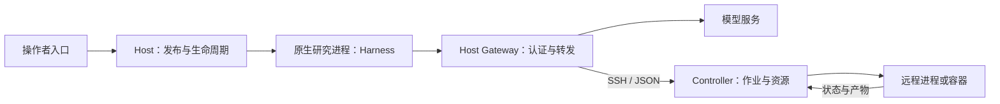

# 系统架构

夜间由单个研究 Agent 持续推进 Policy、采集、训练、评估与分析，提高 A3 2×5、2×10 全量评测的准确率与通过率。白天由维护者依据原始轨迹改进 Harness，验证后发布源码版本。启动与升级步骤见[使用教程](../guides/usage.md)，文件归属见[目录职责](storage-layout.md)。

## 三个组件的职责

源码位于 `src/a3_research_agent/`，按运行职责分成三个组件。

| 组件 | 负责什么 | 运行位置 |
| --- | --- | --- |
| `harness/` | 模型与工具循环、上下文摘要、计划、记忆、skills 和研究文件操作 | 本地研究进程 |
| `host/` | 发布版本装载、进程生命周期、身份认证、模型转发、输入版本与恢复记录 | 本地 Host |
| `execution/` | 作业归属、排队、GPU 分配、执行、取消、产物与只读导出 | 执行服务器 |

Harness 通过 HTTP 调用 Host。Host 把模型请求送到部署者配置的服务，把作业请求绑定身份后经 SSH 交给 Controller。Controller 只依赖 Python 标准库，按请求运行，无需常驻 HTTP 服务。

本地研究进程直接使用宿主账号运行。Host 将模型认证和 SSH 配置留在自身进程，研究进程只获得本轮 Gateway 令牌及运行所需环境。原生执行采用账号的文件权限；可访问范围应通过专用账号和部署目录管理。远程可选择 `process` 或 Docker，详细资源契约见[进程后端](remote-process.md)。

## 发布、工作区与恢复

操作者从明确的 Git commit 发布 Harness。固定源码缓存在 `.runtime/published-harness/v2/<commit>/`，研究文件保存于根目录唯一的 `workspace/`，主动长期经验独立保存在 `memory/entries.jsonl`，模型执行记录按开始时间归档到 `trajectories/YYYY-MM-DD_HH-MM-SS-ffffff/`。私有 workspace 映射固定资源身份与研究目录。每轮只运行一个研究 Agent。

Host 的 `launch.py` 负责启动装配；`sessions/processes.py` 负责创建、观察、停止及恢复原生进程；`sessions/workspace.py` 负责工作区定位、受限文件读取和持久写入。进程以 PID、启动标识和实际命令核对身份，避免停止其他进程。

`--resume-from` 恢复同一 run、身份、工作区、checkpoint、工具 journal 与在途作业。普通恢复要求原发布版本和完整模型配置一致。Host 私有状态和会话记录使用明确的原生 schema；不支持旧 builder 或本地容器记录。

维护者通过离线发布事务升级暂停的 run。升级保留研究目录、模型上下文、计划、长期记忆、自写 skills 与作业归属，同时归档旧版本、输入和 checkpoint 边界。事务可以在中断后继续；具体入口见[操作者监督](../guides/maintenance.md)。

研究 Agent 正常退出后，Host 保存控制台与退出记录。研究进程停止后，Host 保存暂停状态，保留文件与在途远程作业供恢复。`run-outcome.json` 可记录继续研究的进度或需人工处理的外部阻塞。可选的 retained 知识快照保存选定材料与来源。

## 一次实验怎样执行

Agent 按 SOUL 中的研究目标和当前计划，按需读取 A3 方法 skill，准备 `research/` 中的脚本，再用 `job_submit` 提交命令、文件和资源需求。工具计算附件校验值并检查参数，Host 确定归属，Controller 在统一资源根目录中准入和启动。

Host 在传输前保存 job 编号，Controller 按同一编号创建作业。响应丢失时，Agent 查询已有编号；提交工具不自动重发。`GET /jobs` 可以分页找回该身份的远程作业记录。

独立且输入就绪的作业可以并行提交。等待工具在程序层等待作业终态或操作者通知，减少无效模型调用。报告和图像经产物接口取回；长文本支持分页读取，原始材料继续保存在执行端。

Agent 核对模型与数据版本、评测设置、逐回合结果与异常，决定下一步研究。`/checks/comparison` 提供提交条件的字段比较；实验解释和候选选择由 Agent 完成。A3 仿真物理、任务计分与资源仍归属独立的 A3 项目。

## GPU 作业管理

Controller 实例共用资源根目录和调度锁。独占模式持有整卡租约；共享模式记录每作业显存预算，限制活动卡数、每卡预算和实际显存压力。未声明预算的托管作业使用部署配置的单作业默认值，显式预算按请求保留。

超过设备或部署上限的请求直接拒绝；暂时没有资源的请求保留同一队列编号。一次准入复用活动作业扫描与 GPU 观测，可靠回收记录不再反复查询容器状态。其他使用者的负载会影响可用资源，共享账本只协调本项目的 Controller。

可识别的初始化 CUDA 显存竞争支持有限重试，保留逻辑作业编号和每次日志；普通脚本失败和自身预算不足不会触发该重试。完成、取消或超时后释放自有租约。完整配置见[环境配置](../guides/setup.md)。

## 上下文、记忆与 skills

上下文压缩目标覆盖下一次完整模型输入，包括固定指令、工具、运行状态、摘要和最近的完整工具回合。摘要输出空间根据压缩目标与实际模型窗口计算；必要压缩只有得到完整摘要后才继续。失败时保存 checkpoint 和诊断供恢复。详见[上下文与记忆](context-and-memory.md)。

`memory/entries.jsonl` 保存 Agent 主动提炼的经验、适用条件及来源，由 `memory` 工具管理。`recall` 从 `workspace/history.jsonl` 等原始执行历史检索片段；`workspace/context-history/` 保存摘要来源和大工具结果。研究计划与自写 skills 同样保存在 `workspace/`。恢复、未来会话和维护发布共用这些目录。

Host 从根目录 `skills/` 发现包含 `SKILL.md` 与 `assets/catalog-entry.json` 的完整方法包，随公共输入和发布包交付正文、引用文件及 helper，并分别记录版本和文件哈希。Agent 自写 skills 保存在研究工作区；输入更新和安装保留其局部修订，将新部署参考包独立保存。Agent 使用多关键词检索并按需读取正文和附件。

研究目标和行为原则集中在 `prompt/SOUL.md`。`prompt/execution.md` 与 `prompt/workspace.md` 按需提供执行和路径说明，方法 skill 按研究问题检索。

## 观察与维护

Gateway 保存模型用量、请求开始与结束、错误层和耗时；Harness 保存模型消息、工具调用与结果；Controller 保存资源、作业状态与产物。事件通过 run、session 和 job 编号关联。

Host 保存进程停止状态、恢复信息和研究记录。Agent 持续比较模型在全量评测中的表现，由操作者暂停和恢复研究。各次实验保留模型、数据、评测设置与原始证据。

三个 prompt 和研究 skills 按版本装载。运行期间只有操作者可以预览并确认输入或反馈更新，规则见[输入管理](agent-inputs.md)与[操作者监督](../guides/maintenance.md)。

## 维护重点

依据实际执行轨迹减少工具参数错误、无效检索、重复提交和无效模型等待，检查摘要是否完整、经验是否影响后续行动，并衡量端到端研究效率。功能回归、基础设施验证和科学实验结果分别记录。
