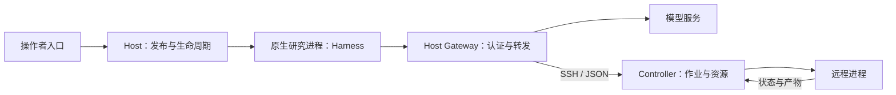

# 系统架构

夜间由 Main Agent 持续推进 Policy、采集、训练、评估与分析，提高 A3 2×5、2×10 全量评测的入盒准确率与通过率。Visual Assistant Agent 筛查录像和多视角帧，Compressor Agent 提供带来源的上下文交接，Deep Research Agent 研读公开资料并提供实验设计证据。Main Agent 负责研究计划和作业。启动与升级见[使用教程](../guides/usage.md)，文件归属见[目录职责](storage-layout.md)。

## 三个组件的职责

源码位于 `src/a3_research_agent/`，按运行职责分成三个组件。

| 组件 | 负责什么 | 运行位置 |
| --- | --- | --- |
| `harness/` | 模型与工具循环、上下文摘要、计划、记忆、skills 和研究文件操作 | 本地研究进程 |
| `host/` | 发布版本装载、进程生命周期、身份认证、模型转发、输入版本与恢复记录 | 本地 Host |
| `execution/` | 作业归属、排队、GPU 分配、执行、取消、产物与只读导出 | 执行服务器 |

Harness 通过 HTTP 调用 Host。Host 把模型请求送到部署者配置的服务，把作业请求绑定身份后经 SSH 交给 Controller。Controller 只依赖 Python 标准库，按请求运行，无需常驻 HTTP 服务。

本地 Harness 作为原生进程运行，Host 保管模型认证和 SSH 配置。模型通过文件工具读写唯一的 `workspace/`，只读当前输入、A3 参考和当前会话状态；技能和长期经验通过专用工具访问。工具集不暴露本地 Bash 或 Python 执行，研究命令交给远程作业。Controller 直接启动 Linux 进程，资源契约见[远程进程作业](remote-process.md)。

## 发布、每日运行与恢复

操作者从明确的 Git commit 发布 Harness。固定源码缓存在 `.runtime/published-harness/v2/<commit>/`，研究文件保存于根目录唯一的 `workspace/`；机器对话状态保存在 `trajectories/<开始时间>/conversation/`；根 `skills/`、`memory/entries.jsonl` 与 `plan/current.json` 分别保存技能、主动长期经验和跨运行研究计划。每天创建新的 run 和模型上下文，每轮由一个 Main Agent 持有共享工作区。A3 参考源码按内容保存在共享 `.runtime/reference-sources/`，各次运行的 `public/a3` 链接到对应只读版本。

Deep Research Agent 由本地 Host 运行，接受 Main Agent 的问题与公开背景。每个 Host 同时运行一个调研任务，有独立模型上下文与来源日志，只能检索、读取公开来源并交付报告。经过检索阶段后切换到报告生成，遇到证据缺口可返回部分报告。已完成的任务可在同一 run 中取回，Host 停止时未完成任务标记为中断。任务状态和资料保存在 trajectory 的 `.host/deep-research/`。

Host 的 `knowledge_service/` 为 memory 和 skills 共用一个本地 embedding 进程及认证服务；两套索引独立保存。技能检索只交付摘要，正文和附件通过 skills 工具按需读取。

Host 的 `launch.py` 负责启动装配；`sessions/processes.py` 负责创建、观察、停止及恢复原生进程；`sessions/workspace.py` 负责工作区定位、受限文件读取和持久写入。进程以 PID、启动标识和实际命令核对身份，避免停止其他进程。

`--resume-from` 恢复同一 run、身份、工作区、checkpoint、工具 journal 与在途作业。普通恢复要求原发布版本和完整模型配置一致。Host 私有状态和会话记录使用明确的原生 schema。

同一天意外中断的 run 可由维护者通过离线发布事务升级后恢复。升级保留研究目录、模型上下文、计划、长期记忆、技能库与作业归属，同时归档旧版本、输入和 checkpoint 边界。事务可以在中断后继续；具体入口见[操作者监督](../guides/maintenance.md)。

研究进程停止后，Host 保存控制台、退出记录与暂停状态，保留研究文件和在途远程作业。Agent 通过 `research_status(...)` 记录继续研究的进展或需人工处理的阻塞，程序保存到当前 `conversation/run-outcome.json`。可选的 retained 记录保存共享工作区文件的路径、哈希与来源，加载时核对内容，避免复制研究代码和实验文本。

## 一次实验怎样执行

Agent 按 SOUL 中的研究目标和当前计划，按需读取 A3 方法 skill，准备 `scripts/<模型或方法>/<可选研究系列>/<用途>/` 中的脚本，再用 `job_submit` 提交命令、文件和资源需求。工具计算附件校验值并检查参数，Host 确定归属，Controller 在统一资源根目录中准入和启动。

Host 在传输前保存 job 编号，Controller 按同一编号创建作业。响应丢失时，Agent 查询已有编号；提交工具不自动重发。`GET /jobs` 可以分页找回该身份的远程作业记录。

独立且输入就绪的作业可以并行提交。等待工具在程序层等待作业终态或操作者通知，减少无效模型调用。报告和图像经产物接口取回；长文本支持分页读取，原始材料继续保存在执行端。

Agent 核对模型与数据版本、评测设置、逐回合结果与异常，决定下一步研究。`/checks/comparison` 提供提交条件的字段比较；实验解释和候选选择由 Agent 完成。A3 仿真物理、任务计分与资源仍归属独立的 A3 项目。

## GPU 作业管理

Controller 实例共用资源根目录和调度锁。独占模式持有整卡租约；共享模式记录每作业显存预算，限制活动卡数、每卡预算和实际显存压力。未声明预算的托管作业使用部署配置的单作业默认值，显式预算按请求保留。

超过设备或部署上限的请求直接拒绝；暂时没有资源的请求保留同一队列编号。一次准入复用活动作业扫描与 GPU 观测。其他使用者的负载会影响可用资源，共享账本只协调本项目的 Controller。

可识别的初始化 CUDA 显存竞争支持有限重试，保留逻辑作业编号和每次日志；普通脚本失败和自身预算不足不会触发该重试。完成、取消或超时后释放自有租约。完整配置见[环境配置](../guides/setup.md)。

## 上下文、记忆与 skills

上下文压缩目标覆盖下一次完整模型输入，包括固定指令、工具、运行状态、摘要和最近的完整工具回合。32k 是软目标，大工具观察可在模型硬预算内提升目标。研究交接按七个部分生成，经过来源摘录、数字和作业编号校验后发布。临时服务故障持续退避重试；必要压缩未完成时在原进程等待，明确错误进入可观察的阻塞状态，响应操作者暂停和停止。每轮从最新 plan、近期关键工具回执与 memory 重新组装状态，供 Agent 核对旧摘要。详见[上下文与记忆](context-and-memory.md)。

`memory` 管理主动经验、适用条件与来源；`recall` 检索原始执行历史。Host 用 `A3_STATE_ROOT` 指定当前 `conversation/`，其中保存 `history.jsonl`、`context-history/` 和大工具结果。逻辑归档引用以 `runtime_paths.state` 为基准，保留原文哈希，可通过普通文件工具只读核对。

`plan` 工具维护根 `plan/current.json` 中的长期方向、研究路线与假设、执行步骤和复盘记录，每次模型请求携带计划摘要及待复盘作业。Agent 依据结果调用 `review` 保存结论并选择继续、暂停或完成路线。`runtime_paths.plan` 提供实际路径。每次启动、计划修订和停止时，在当前 trajectory 的 `plan-snapshots/` 保存历史快照；新运行和恢复读取根计划的最新内容。`conversation/` 集中保存接续与恢复清单、运行状态、checkpoint、工具 journal、轨迹、操作台账、压缩事务和故障记录。研究进展统一由 plan 管理，恢复清单由程序生成。`workspace/scripts/` 按模型或方法、研究系列和用途保存源码，`workspace/experiments/<日期-实验名>/` 保存实验配置、结果与分析。Host 恢复与离线发布继续使用原会话状态和研究文件。

根 `skills/` 是唯一技能库，所有技能使用相同工具权限。`skills` 先返回摘要，再按需读取正文和附件；修改使用当前哈希，自动递增包版本并把完整旧包归档到 `.runtime/skill-revisions/`。技能库独立于三个 prompt 的发布快照。

研究目标和行为原则集中在 `prompt/SOUL.md`。`prompt/execution.md` 与 `prompt/workspace.md` 按需提供执行和路径说明，方法 skill 按研究问题检索。

## 观察与维护

Gateway 保存模型用量、请求开始与结束、错误层和耗时；Harness 保存模型消息、工具调用与结果；Controller 保存资源、作业状态与产物。事件通过 run、session 和 job 编号关联。

Host 保存进程停止状态、恢复信息和研究记录。Agent 持续比较模型在全量评测中的表现，由操作者暂停和恢复研究。各次实验保留模型、数据、评测设置与原始证据。

三个 prompt 通过 input revision 装载，技能库独立记录版本和修改历史。运行期间只有操作者可以预览并确认输入或反馈更新，规则见[输入管理](agent-inputs.md)与[操作者监督](../guides/maintenance.md)。

## 维护重点

依据实际执行轨迹减少工具参数错误、无效检索、重复提交和无效模型等待，检查摘要是否完整、经验是否影响后续行动，并衡量端到端研究效率。`harness/drift.py` 只负责对漂移做有界纠正，`harness/job_failure.py` 只命名日志已经显示的失败，`harness/ledger.py` 只记录作业与压缩事件；它们都不参与科学判断。功能回归、基础设施验证和科学实验结果分别记录。

模型工具目录由 `harness/tool_catalog.py` 统一声明，参数与结果通过高层工具转换。HTTP 请求只在 `agent.request_host` 和 Host 内部传递；模型不获得通用 method/path/body 入口。`file_tools.py`、`job_tools.py`、`host_tools.py` 和 `control_tools.py` 分别负责文件、作业、资源与资产、等待和运行状态。
