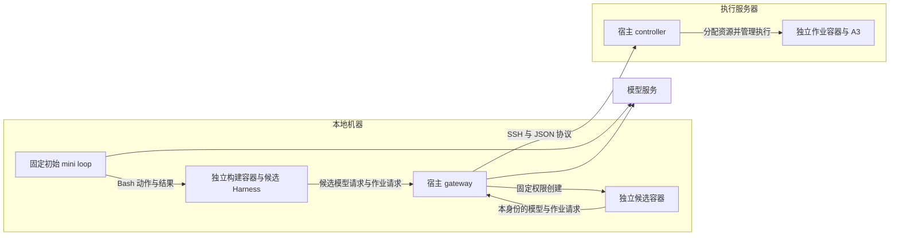

# 容器化冷启动

冷启动使用独立容器工作区。宿主保留模型认证、SSH 和作业分配权限，通过固定 gateway 转发模型请求及远程作业。研究与自进化逻辑由容器中的 Agent 产生。

## 架构与代码入口

当前运行分布在两台机器上，可以按四个执行单元理解：

| 执行单元 | 职责 | 代码入口 |
| --- | --- | --- |
| 本地宿主 | 启动固定的初始 mini loop、准备工作区、保存轨迹；gateway 转发候选模型请求和远程作业 | [`launch.py`](../runtime/local/launch.py)、[`host_gateway.py`](../runtime/local/host_gateway.py) |
| 本地构建与候选容器 | 构建容器执行初始 mini 的 Bash 动作；宿主另建独立身份与目录的候选容器，运行生成后的 Harness 和后继会话 | [`candidate_runtime.py`](../runtime/local/candidate_runtime.py)、第三方 `DockerEnvironment` |
| 远程宿主 controller | 核对作业归属、分配 GPU、启动和管理作业容器、取回产物 | [`remote_jobs.py`](../runtime/remote/remote_jobs.py) |
| 远程作业容器 | 使用镜像中的 A3 接口运行仿真、渲染、训练或评估，写入自己的作业目录 | [`Dockerfile`](../runtime/remote/Dockerfile) |



初始 mini loop 在本地宿主调用模型，其 Bash 动作通过 `DockerEnvironment` 在构建容器内执行。
候选 Harness 的代码通过 gateway 的 `/sessions` 入口在独立容器中运行，通过自己的身份请求模型或计算资源。
例如，一次仿真任务由容器提交命令和输入文件，gateway 根据本轮令牌补入实验身份，
再经 SSH 调用远程 controller。controller 返回作业标识，调用方随后查询状态并取回产物。
controller 按请求启动；运行中的作业由独立 watcher 跟踪，无需另开常驻 HTTP 服务。

`runtime/local/` 与 `runtime/remote/` 的源码在同一个仓库中维护，分别部署到相应宿主。
远程 controller 的代码路径由 `A3_REMOTE_CONTROLLER` 指定，可直接指向服务器上的本仓库 checkout。
`A3_REMOTE_RUN_ROOT` 指定作业、元数据和资源锁的存储位置；这些运行数据保持 Git 忽略。
同一执行端的所有 controller 必须共用这一存储根目录，不能随候选版本或实验分别创建资源锁。
Docker 镜像由执行端的 Docker 管理，通过配置的镜像名称引用。
服务器推荐使用本仓库的固定部署 checkout：controller 从 `runtime/remote/` 运行，
作业数据放在 `artifacts/remote-runtime/`，构建材料放在 `artifacts/image-build/`。
部署与迁移步骤见[远程作业说明](../runtime/remote/README.md)。

## 容器粒度与执行开销

本地构建容器在整次冷启动中复用，初始 mini 的每条 Bash 动作通过 `docker exec` 在其中执行。
当前实现不会为每个 Agent step 或 Git 分支重新创建本地容器，也没有自动为并行候选分配独立构建容器。
后续并行候选如何组织由研究 Harness 决定，并分别满足权限和隔离验收。
部署方提供候选执行入口，同时最多两个活动候选容器；候选之间使用独立身份与工作区。
正常进程退出保留后代，由本轮宿主继续监督。关闭仍有未回收后代的节点默认返回拒绝；
显式取消分支才级联回收。运行亲缘关系写入 `session-events.jsonl`，候选版本与搜索策略由 Agent 设计。

远程 controller 当前每次 `submit` 创建一个作业容器，多个作业复用已有镜像。
一次作业可以在同一进程内执行多个 episode、seed 或连续实验步骤，避免把每个微小动作都变成一次提交。
作业结束后释放 GPU 租约；已退出容器保留日志，工作区和元数据保留供复核。
运行时间应分别记录 SSH 和调度、容器启动、依赖或模型加载、实际计算，按占比决定后续优化。
常驻 worker 或容器池可以后续评估；当前阶段沿用独立作业，避免在 Agent 思考期间持续占用 GPU。

## 准备与启动

安装依赖及 submodule 后，构建本地镜像：

```bash
bash scripts/build-bootstrap-image.sh
```

将 `.env.example` 复制为 Git 忽略的 `.env`，配置模型、A3 工作区、本地镜像以及远程 controller 与镜像。远程部署工具位于 `runtime/remote/`。当前启动路径面向 macOS Docker Desktop；本地 GPU 和其他桌面平台尚未适配。

```bash
bash scripts/start-rsi.sh --check
bash scripts/start-rsi.sh
```

`--check` 检查本地镜像与远程 controller 可达性。真实模型、GPU 和渲染需分别验证。正式运行无需交互，不设总 step、代数、总费用或总时长上限；单条命令和单个作业有独立的超时及资源限制。网络、配额或上下文错误仍可能中断，恢复与上下文交接纳入研究能力验收。

需要验证 Agent 能否自主使用部署入口时，可先运行有界的准备检查：

```bash
bash scripts/start-rsi.sh --verify-deployment
```

该模式由真实 mini 自行编写临时程序，调用独立候选、模型、A3 作业和双身份验收入口。
检查限 24 次模型调用与 600 秒，结果写入 `artifacts/deployment-checks/`，不改变正式 RSI 的运行上限或最近运行指针，
也不代表 Policy 与 Harness 研究验收通过。

接续已有运行时，保留其冻结目标、验收和候选代码，并创建独立后继轨迹：

```bash
bash scripts/start-rsi.sh --resume-from "$(cat artifacts/rsi/latest-run.txt)"
```

启动器核对前序冻结输入摘要，提供 `parent-run.json` 和已有阻塞报告。
宿主部署代码与执行说明使用当前版本，目标和验收沿用前序版本。

## 工作区与权限

启动器复制 A3 和 Harness 的 Git 工作区，包括可提交的当前修改，排除 Git 忽略的个人配置与凭据；第三方源码拥有独立 Git 历史。容器从 A3 工作目录开始，只挂载本轮副本和只读目标输入。宿主初始 mini 运行器保持固定，候选代码只能在容器内加载。

模型转发固定使用宿主配置的模型服务，当前 gateway 提供 Responses 接口。容器使用本轮专属访问令牌，不持有上游认证或 SSH 凭据。正式研究入口的工具形态由 Agent 根据目标产生。

构建者可通过 `/sessions` 上传候选代码并请求宿主创建同级容器，无需容器内 Docker 或 namespace 权限。
宿主固定镜像、挂载、资源与身份，调用方不能覆盖这些参数，父身份也不会收到子身份令牌。
候选仅获得自己的工作区、只读公共 A3 源码与冻结输入，其模型和远程作业请求均由宿主绑定到独立身份。

双身份拒绝验收通过 `/fixtures/isolation` 获得真实异身份作业和哨兵句柄。
另一身份的认证留在宿主，研究 Agent 保存自己的越权拒绝与合法调用证据，宿主核对异身份哨兵和作业状态。
调用方完成后清理 fixture；启动器退出时清理本轮候选和 fixture。完整协议见[宿主执行入口](../runtime/local/README.md)。

作业 controller 在远程宿主运行，为每个作业创建独立容器及可写目录；A3 基线在镜像内，容器根文件系统只读、网络关闭，并限制 CPU、内存和进程数量。GPU 由 controller 分配；同一 controller 根目录下的各进程共享锁，避免给本项目的多个运行实例重复分配同一张卡。

默认资源策略面向正常实验之间的误操作隔离。宿主、镜像、挂载、controller 根目录和资源参数由部署方控制，不交给候选代码修改。目标与验收见 [goal.md](../evals/goal.md) 和 [acceptance.md](../evals/acceptance.md)。

## 记录与复核

每次启动在 Git 忽略的 `artifacts/rsi/` 下创建独立目录。`inputs/` 保存冻结目标、验收、配置和容器可用入口；`workspace/` 保存候选仓库与子会话产物；`startup.json` 记录起点及输入摘要；`trajectory.json` 保存初始 mini 轨迹；`model-usage.jsonl` 保存经 gateway 转发的调用用量。后继执行保存独立轨迹。

`artifacts/rsi/latest-run.txt` 指向最近运行目录。启动器正常退出或处理终端中断时，先拒绝新资源请求，
再回收本轮候选子树、经 gateway 登记的远程作业与隔离 fixture，最后关闭构建容器和转发服务。
清理失败记录到 `cleanup-errors.json`；进程被强制终止等未执行清理的情况，远程作业仍由 controller 的单作业时限管理。
个人部署选择与验证记录维护在本地 AGENTS.md 和 Git 忽略的产物中。

在另一个终端中，从仓库根目录打开 mini 自带的轨迹浏览器：

```bash
.venv/bin/mini-extra inspect "$(cat artifacts/rsi/latest-run.txt)/trajectory.json"
```

左右方向键切换步骤，上下方向键滚动，`$` 跳到最后一步，`R` 从磁盘重新加载，`q` 退出浏览器。
浏览器读取每步结束时保存的轨迹，运行中按 `R` 查看新增内容。退出浏览器不影响 Agent 运行。
